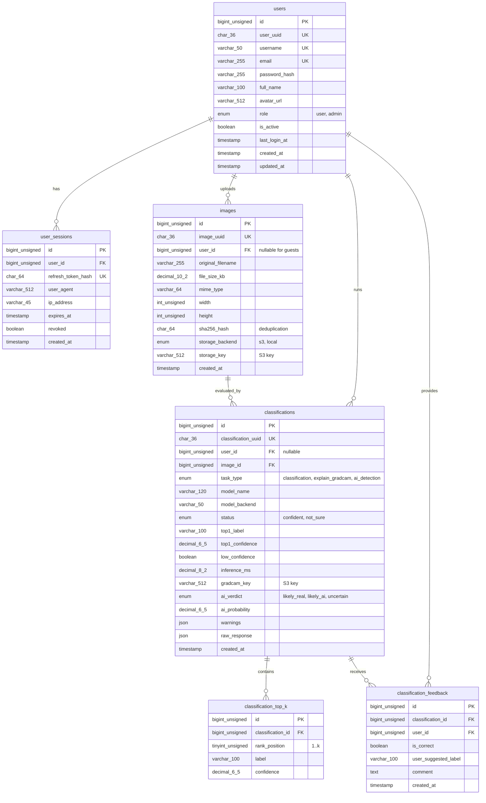

# SmartVision - MySQL Database Architecture & Schema Reference

This document details the production relational database schema designed for **SmartVision** using **MySQL 8.0+**. It is designed to store user accounts, authentication sessions, image upload metadata, model predictions (`/predict`), Grad-CAM visual explanations (`/explain`), and AI-generated image detection results (`/detect-ai`).

---

## 1. Entity-Relationship (ER) Diagram



---

## 2. Table Specifications

### 2.1 `users`
Represents registered end-users and administrators.
- **`id`** (`BIGINT UNSIGNED AUTO_INCREMENT PRIMARY KEY`): Internal cluster index key.
- **`user_uuid`** (`CHAR(36) NOT NULL UNIQUE`): Public UUID exposed in REST APIs to avoid leaking sequential record counts.
- **`username`** (`VARCHAR(50) NOT NULL UNIQUE`): Unique login handle.
- **`email`** (`VARCHAR(255) NOT NULL UNIQUE`): Email address for notifications and login.
- **`password_hash`** (`VARCHAR(255) NOT NULL`): Salted password hash (bcrypt / argon2).
- **`role`** (`ENUM('user', 'admin') DEFAULT 'user'`): Access control tier.
- **`is_active`** (`BOOLEAN DEFAULT TRUE`): Soft-disable switch.
- **`created_at` / `updated_at`**: Automatic audit timestamps.

### 2.2 `images`
Tracks image assets processed by SmartVision.
- **`user_id`** (`BIGINT UNSIGNED NULL`): `ON DELETE SET NULL` ensures inference history remains intact even if a user account is removed.
- **`original_filename`** (`VARCHAR(255)`): Uploaded filename.
- **`file_size_kb`** (`DECIMAL(10, 2)`): File size in kilobytes.
- **`width` / `height`** (`INT UNSIGNED`): Decoded pixel dimensions.
- **`sha256_hash`** (`CHAR(64)`): SHA-256 fingerprint for deduplication and inference cache lookups.
- **`storage_key`** (`VARCHAR(512)`): S3 object key (e.g. `uploads/3f8a...jpg`) or local path.

### 2.3 `classifications`
The core prediction record generated by `/predict`, `/explain`, or `/detect-ai`.
- **`task_type`** (`ENUM('classification', 'explain_gradcam', 'ai_detection')`): Specifies whether this was standard classification, Grad-CAM heatmap explanation, or AI-generated artifact detection.
- **`model_name`** (`VARCHAR(120)`): Exact model identifier (e.g., `ResNet-50 (ImageNet pretrained, 1000 classes)`).
- **`top1_label`** (`VARCHAR(100)`): Most likely class (e.g., `golden_retriever`, `AI-generated`). Indexed for queries.
- **`top1_confidence`** (`DECIMAL(6, 5)`): Calibrated probability score (0.00000 to 1.00000) with a database check constraint (`chk_top1_conf`).
- **`low_confidence`** (`BOOLEAN`): True if below confidence threshold (`CONF_THRESHOLD`).
- **`inference_ms`** (`DECIMAL(8, 2)`): Inference processing latency in milliseconds.
- **`gradcam_key`** (`VARCHAR(512) NULL`): S3 key where the Grad-CAM overlay PNG is saved (`gradcam/uuid.png`).
- **`ai_verdict` / `ai_probability`**: Enriched fields for AI image detection runs (`likely_real`, `likely_ai`, `uncertain`).
- **`warnings`** (`JSON NULL`): Warning codes (e.g., `["low_resolution"]`).
- **`raw_response`** (`JSON NULL`): Full JSON response for caching, replay, and offline auditing.

### 2.4 `classification_top_k`
Normalized Top-K candidate predictions (e.g., Top-3 or Top-5 candidates).
- **`rank_position`** (`TINYINT UNSIGNED`): Rank (1 for top-1, 2 for top-2, etc.).
- **`label`** (`VARCHAR(100)`): Class name.
- **`confidence`** (`DECIMAL(6, 5)`): Candidate score.
- **Unique Constraint**: `(classification_id, rank_position)` prevents duplicate ranks.
- **Index**: `(label, confidence DESC)` enables class distribution and aggregation analytics.

### 2.5 `classification_feedback`
Crowdsourced validation and ground truth collection.
- Enables users to confirm if the classification was correct or provide true labels for active learning and model retraining pipelines.

---

## 3. Performance & Indexing Strategy

1. **User Scan History Index**:
   ```sql
   INDEX idx_classifications_user_history (user_id, created_at DESC)
   ```
   Directly satisfies queries fetching a user's recent scans for pagination (`ORDER BY created_at DESC LIMIT 20`) without filesort.
2. **Duplicate Detection Index**:
   ```sql
   INDEX idx_images_sha256 (sha256_hash)
   ```
   Enables `O(1)` check if an identical image was already processed, allowing instant cached response retrieval.
3. **Class Occurrence Analysis Index**:
   ```sql
   INDEX idx_classifications_top1 (top1_label)
   ```
   Provides high-speed grouping and filtering by predicted object class.

---

## 4. Frontend History Integration View

The SQL View `v_user_classification_history` joins `classifications`, `images`, and `users`:

```sql
SELECT 
    record_id,
    image_name,
    storage_key,
    top1_label,
    confidence_percentage,
    status,
    inference_ms,
    scan_timestamp
FROM v_user_classification_history
WHERE user_id = ?
ORDER BY scan_timestamp DESC
LIMIT 20;
```
This query returns the exact data columns expected by `frontend/src/ClassificationHistory.jsx`.

---

## 5. Running with Docker Compose

To start MySQL alongside the backend:
```bash
docker compose up -d
```
MySQL will start, initialize the database automatically using `database/schema.sql`, run health checks, and make port `3306` available.

